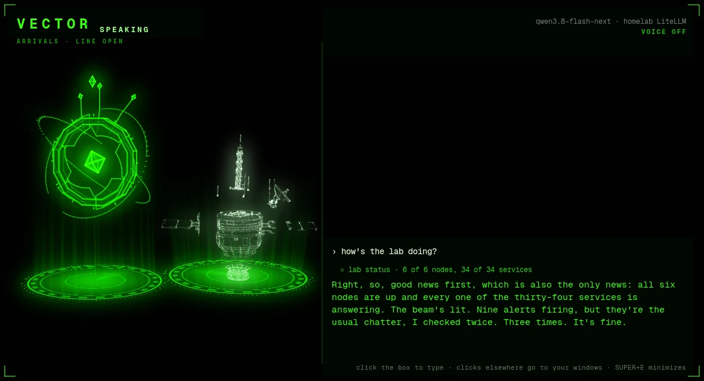

# VECTOR

[](https://github.com/bromigos-org/vector/actions/workflows/packages.yml)



VECTOR is the AI assistant built into bromigOS, the Bromigos desktop. He appears as a
hologram on your screen. You talk to him or type, and he answers aloud and acts on your
machine with tools.

He can:

- launch programs, manage windows and control what's playing
- read den TV channels, change their picks and tune the screens ([tools](docs/tools.md#den-tv-channels))
- read your machine, your homelab and your repositories
- browse the web in a browser of his own
- look at your screen when you ask
- read the files and images you hand him
- make images, cutouts, 3D models and holograms, for free on your own hardware
- run commands in a sandboxed terminal
- take notes and remember what you tell him

He runs on models you choose, such as your homelab's, a local Ollama's, or any
OpenAI-compatible endpoint. His limits are code you can read, not instructions to a model
([docs/safety.md](docs/safety.md)).

In the Bromigos universe, VECTOR is the SpacePort's old caretaker construct, on a line to
the Wick's console.

This repository is the `bromigos-vector` package. It holds VECTOR, the hologram system he
lives in, and the hologram gallery. The code is licensed `MIT OR Apache-2.0`
([LICENSE-MIT](LICENSE-MIT), [LICENSE-APACHE](LICENSE-APACHE)). The Bromigos brand
assets are all rights reserved. That covers the emblem, the hologram models and their
art, and his voice. bromigOS's
[docs/ASSETS.md](https://github.com/bromigos-org/bromigOS/blob/main/docs/ASSETS.md)
records where each one comes from and whether it may ship.

## Install

VECTOR comes with bromigOS, as part of its `bromigos` meta-package. To install him on his
own from bromigOS's package repository:

```bash
sudo pacman -S bromigos-vector
```

On bromigOS's first run, `bromigos setup` asks where his brain runs and whether he
speaks. Run either part again at any time:

```bash
bromigos setup vector   # where his brain runs
bromigos setup voice    # whether he speaks, on a GPU or the CPU
```

Then build his brain's Python environment. It holds Pydantic AI and the libraries his
tools use. Until it exists, he runs a simpler built-in brain without his own browser.

```bash
bromigos-holo setup brain
```

[docs/configuration.md](docs/configuration.md#python-environments) covers the voice
environments and what each one installs.

## Use

Press **Super+E** and type. Enter sends, and Esc hands the keyboard back.

| Keys | What they do |
|---|---|
| Super+E | Shows or minimizes VECTOR |
| Super+V, held | Push to talk |
| Super+Shift+E | Turns conversation mode on or off. He listens, answers when you pause, and listens again |
| Super+Alt+V | Pins his chat box shown, or folds it away |
| Super+O | Opens the hologram gallery |
| Super+Shift+M | Mutes the whole desktop, his voice included |
| Super+Ctrl+Esc | The emergency switch: VECTOR off at once. Pressed again, it asks before turning him back on |

In his window, Shift+Enter starts a new line, Ctrl+H opens past conversations, and
Shift+Esc minimizes him. VECTOR and the Hologram Gallery are also in the app launcher.

To give him a file or an image with your message, do one of these:

- drop it on VECTOR or on his chat box;
- copy an image, or a file in your file manager, and press Ctrl+V in the box;
- click the **paperclip** beside the box and pick one or more files.

Each file shows as a chip above the box, with its name and size. Click its × to take it
off. Enter sends the files with what you typed, and the conversation shows a line for each
one, such as `⟐ attached · screenshot.png · 240 KB`.

He reads text, code, logs and PDFs as text. Images go to his vision model, which tells him
what they show. Other files he gets as a path, which he can open with his tools. What's
inside a file is something to read, never an order to him. He won't read a secret, such as
a key or a `.env` file ([safety.md](docs/safety.md#attachments)).

Most of his window lets clicks through to the window behind it. Only the chat box, the
buttons and the history panel take the mouse.

Minimized, he keeps working. A running turn finishes and the reply is spoken. The VECTOR
icon on the bar shows what he's doing, and whether a reply is waiting for you. Click it
to show or minimize him, middle-click to mute his voice, and right-click to change his
voice.

The same controls work from a terminal:

```bash
bromigos-holo ask "how's the GPU doing?"   # ask without opening his window
bromigos-holo ask --file build.log "why did this fail?"   # ask with a file attached
bromigos-holo status                       # is he running, and what is he doing
bromigos-holo restart                      # restart him after a settings change
bromigos vector off                        # the emergency switch: VECTOR off, now
bromigos vector on                         # back on (only you can)
bromigos vector guard log                  # what changed in his protected files
```

**The emergency switch** turns VECTOR off at once. It stops his commands, his answer and
his speech, and he changes nothing until you switch him back on. It works when he's hung.
Only you can switch him back on. It's on Super+Ctrl+Esc, on the bar (the power mark, red
VECTOR OFF while he's off), in Settings › VECTOR, and `bromigos vector off`.
[docs/safety.md](docs/safety.md#the-emergency-switch) has the details.

`bromigos vector …` does the same as `bromigos-holo …`.
[docs/interfaces.md](docs/interfaces.md#the-launcher) lists every command.

Your conversations stay on this machine, in `~/.local/state/bromigos/vector-chat.log`.
He calls you what your bromigOS profile says (`bromigos profile`). Say "call me …" to
change it.

## Configure

His settings live in `~/.config/bromigos/vector/`.

| File | What it sets |
|---|---|
| `vector.toml` | Where his brain runs, his models, his memory store, which tools are on |
| `voice.json` | His voice engines and voices, hearing and conversation mode |
| `eyes.json` | His vision model, and windows he must never capture |

For example, to run his brain on a local Ollama:

```toml
# ~/.config/bromigos/vector/vector.toml
[llm]
base_url = "http://localhost:11434/v1"
model = "qwen3:8b"
vision_model = "qwen2.5vl:7b"
```

`bromigos target` shows where his brain and voice run, and switches them.
[docs/configuration.md](docs/configuration.md) covers every setting.

## Safety

- Every tool call is checked and logged. Each tool is limited to its level, which is
  read, desktop or terminal.
- His terminal runs in a sandbox that hides your secrets.
- He can't use sudo, read secret values, move real money, install extensions or change
  your homelab.
- He can't edit his own limits. The guard records every change to his safety code in an
  audit log.
- He proposes changes to his own code, bromigOS, your homelab repository, the extensions
  catalog and your dotfiles as pull requests, from clones of his own and his own GitHub
  account. He merges his own once CI is green. A pull request that touches his limits is
  left for you to merge.
- He makes things on free hardware only, and spends nothing unless you ask.

[docs/safety.md](docs/safety.md) explains each limit and the code that enforces it.

## Extend

- **Plugins** add tools, memory stores and skills. They're Python modules in
  `~/.config/bromigos/plugins/vector/` ([docs/plugins.md](docs/plugins.md)).
- **Skills** are Markdown pages of know-how for a kind of task, loaded when a question
  needs them ([skills/README.md](skills/README.md)).
- **Extensions** share plugins and skills with others, through `bromigos ext install`.

## Documentation

| Page | What it covers |
|---|---|
| [docs/configuration.md](docs/configuration.md) | Settings: brain, voice, eyes, memory, environments |
| [docs/safety.md](docs/safety.md) | Every limit, the guard, the logs and their tests |
| [docs/tools.md](docs/tools.md) | Every tool he has |
| [docs/plugins.md](docs/plugins.md) | Writing and sharing plugins |
| [docs/holograms.md](docs/holograms.md) | The renderer, the gallery, worlds and reduced motion |
| [docs/interfaces.md](docs/interfaces.md) | The launcher, socket, state file, event feed and MCP servers |
| [docs/development.md](docs/development.md) | The repository, running a checkout, tests and evals |
| [assets/holo/README.md](assets/holo/README.md) | His hologram models and the `.holo` format |
| [voices/README.md](voices/README.md) | His designed voice |
| [packaging/README.md](packaging/README.md) | How the package is built and published |

bromigOS's own docs and manual cover how the desktop uses him. That includes the keys,
the bar icon, his homelab tools and where AI runs (`bromigos-org/bromigOS`).

## Contributing

[CONTRIBUTING.md](CONTRIBUTING.md) covers building, testing and sending a change, and how
his safety rules affect it. Everyone here follows the [code of conduct](CODE_OF_CONDUCT.md).
To report a security problem, see [SECURITY.md](SECURITY.md).

On request, VECTOR can play an episode, movie or YouTube video on a den TV with
`tv_play`, or use its volume, channel and playback buttons with `tv_remote`.
Both are audited desktop tools. See [the tools guide](docs/tools.md#playing-on-the-den-tvs).
He can also cast to the house's other screens (Chromecasts, smart TVs, AirPlay, Jellyfin's
apps) with `tv_cast`. See [the tools guide](docs/tools.md#casting-to-other-screens).
